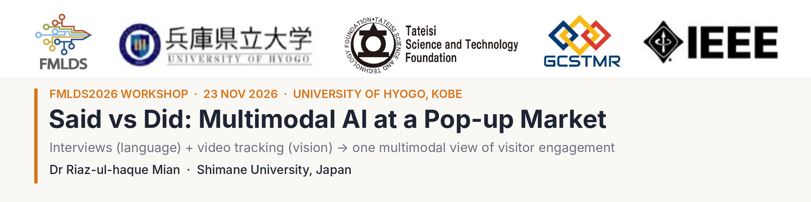

# Said vs Did: Multimodal AI at a Pop-up Market
**FMLDS2026 Workshop — *Federated and Multimodal AI in the Wild***
📅 Monday 23 November 2026 · 13:00–14:30 JST · Room 720, University of Hyogo, Kobe
👤 Dr Riaz-ul-haque Mian, Shimane University, Japan

At a small Sunday-morning market in Matsue, Japan, we **asked** visitors what caught their attention (interviews → *language*) and we **filmed** what they actually did (video → *vision*).
In this hands-on workshop you will analyse both modalities with real (anonymised) data and fuse them to answer one question: **do people do what they say?**

---

📑 **Workshop slides:** [PDF](slides/FMLDS2026_Workshop_SaidVsDid.pdf) · [PowerPoint](slides/FMLDS2026_Workshop_SaidVsDid.pptx) · 🎬 [Pipeline explainer video (3 min)](slides/SaidVsDid_pipeline_explainer.mp4)

## 🚀 Start here
1. Open a notebook below with **Open in Colab**.
2. In Colab choose **File → Save a copy in Drive**. The shared notebook is read-only, so your own copy is where you can run and edit.
3. Run the first cell. It downloads this repository into your Colab session.

| # | Notebook | Modality | What you do | Time | |
|---|---|---|---|---|---|
| 1 | **Interviews → Keywords → Weights** | language | TF-IDF, AI-assisted keyword expansion, dictionary mapping, baseline weighting | 20 min | [](https://colab.research.google.com/github/riazcseiu/fmlds2026-multimodal-workshop/blob/main/notebooks/01_interview_keywords.ipynb) |
| 2 | **Sentiment → Adaptive Weighting** | language | VADER vs RoBERTa, modality bias, adaptive per-participant weighting | 15 min | [](https://colab.research.google.com/github/riazcseiu/fmlds2026-multimodal-workshop/blob/main/notebooks/02_sentiment_adaptive.ipynb) |
| 3 | **Video → People → Stops** | vision | Live YOLOv11 + DeepSORT, trajectories, heatmaps, stop & dwell detection | 15 min | [](https://colab.research.google.com/github/riazcseiu/fmlds2026-multimodal-workshop/blob/main/notebooks/03_vision_tracking.ipynb) |
| 4 | **Fusion: Said vs Did** | both | Perceptual–behavioural gap, explanatory factors, live audience data | 15 min | [](https://colab.research.google.com/github/riazcseiu/fmlds2026-multimodal-workshop/blob/main/notebooks/04_fusion_gap.ipynb) |

> 💡 For notebook 3 choose **Runtime → Change runtime type → T4 GPU** (it also runs on CPU, more slowly).

## 🗓 Workshop plan (90 min)
| Time | Part |
|---|---|
| 13:00 | Story and goals · scan QR · open Colab |
| 13:10 | Notebook 1: the language modality, keywords and weights |
| 13:30 | Notebook 2: sentiment and fair (adaptive) weighting |
| 13:45 | Notebook 3: the vision modality, tracking and stops |
| 14:00 | Notebook 4: fusion and the gap |
| 14:10 | 🙋 Live group activity: you are the interviewees |
| 14:25 | Take-aways and Q&A |

## 📁 Repository
```
notebooks/            four Colab notebooks (pre-run, so you can read the outputs before running)
data/
  interviews/         Imagine Coffee interviews: onsite · video · virtual (anonymised teaching subset)
  keywords/           human-reviewed keyword dictionary + stall dictionary
  tracking/           YOLOv11 + DeepSORT trajectories, stops and summary for 3 clips
  video/              face-blurred tracked clip, trajectory animation, scene background
  audience/           sample answers for the live group activity
  stall_scores_paper.csv   stall-level P, B and factor ratings from the FMLDS2026 paper
papers/               the two open-access papers this workshop builds on (CC BY 4.0)
slides/               workshop slides
assets/               logos and banner
```

## 🔒 About the data
- **Interviews.** A small teaching subset of the Imagine Coffee interviews: 8 on-site visitors (S01–S08) and 4 remote participants (R01–R04) who took part in both the video and the virtual-walkthrough sessions. Names are removed, participants are sub-sampled and about 10 % of utterances are randomly dropped. Use it for learning, not for research claims.
- **Video.** Faces are blurred automatically and the near-camera corner is masked. Trajectory files contain only an anonymous ID and pixel positions.
- The original data belong to the authors' research projects and are not redistributed.

## 📚 Papers
- R.-u.-h. Mian, Y.-K. Nguyen-Tran. *AI-Driven Multi-Modal Assessment of Visual Impression in Architectural Event Spaces: A Cross-Cultural Behavioral and Sentiment Analysis.* **World** 2026, 7, 21. [doi:10.3390/world7020021](https://doi.org/10.3390/world7020021)
- Y.-K. Nguyen-Tran, A. Majiid, R.-u.-h. Mian. *Data-Driven Spatial Analysis: A Multi-Stage Framework to Enhance Temporary Event Space Attractiveness.* **World** 2025, 6(2), 54. [doi:10.3390/world6020054](https://doi.org/10.3390/world6020054)
- M. S. bin Mohd Jamil, Y.-K. Nguyen-Tran, R.-u.-h. Mian. *Dual-Modal Analysis of Visitor Engagement in a Small-Scale Temporary Event: Integrating Perceptual and Behavioral Data.* FMLDS2026 (Paper 179).

## 🙏 Acknowledgements
Fieldwork funded by the Obayashi Foundation. We thank the organisers of the Imagine Coffee Event, Matsue, for permission to observe and record.

**Contact:** riaz@cis.shimane-u.ac.jp
